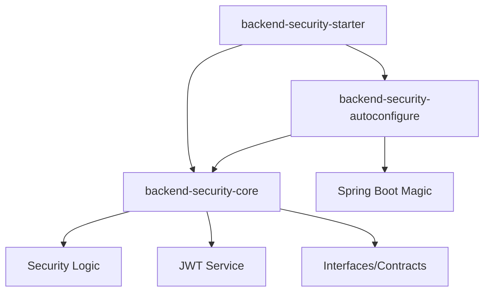
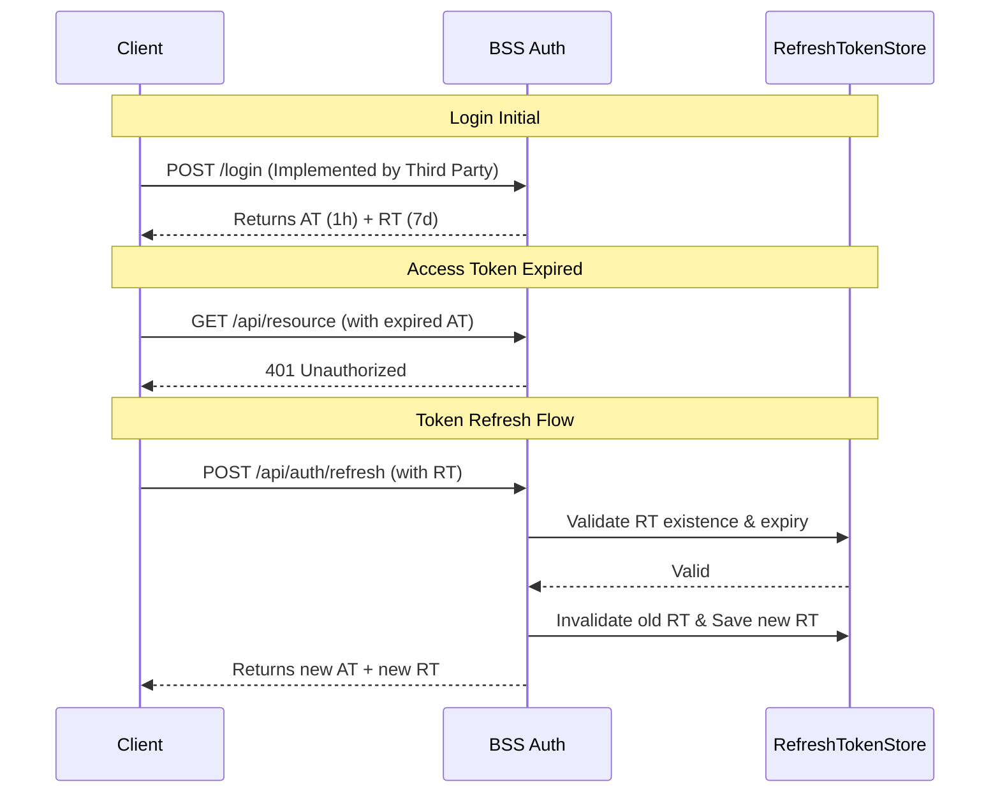

# 🚀 Backend Security Starter (BSS)

<!-- versions:start - bloque generado por scripts/sync-versions.mjs desde pom.xml; no editar a mano -->
[](https://jitpack.io/#CharlyZeta/Backend-Security-Starter)
[](https://github.com/CharlyZeta/Backend-Security-Starter/releases)
[](LICENSE)
[](https://github.com/CharlyZeta/Backend-Security-Starter/actions)


<!-- versions:end -->

Reusable and scalable security component (Starter) for microservices, prioritizing simplicity, functionality, and ease of integration for third parties.

## 🎯 Objetivo
Proveer una solución de seguridad robusta, desacoplada y de alto rendimiento para aplicaciones Spring Boot, facilitando la implementación de autenticación JWT Stateless con soporte para Refresh Tokens y una API de gestión integrada.

## 🏗 Arquitectura del Sistema

El proyecto sigue una estructura multi-módulo para separar la lógica pura del mecanismo de autoconfiguración de Spring Boot.



1.  **backend-security-core:** Contiene los filtros, servicios de JWT, modelos, el selector de modo de identidad (`local` | `oidc`) y las interfaces (`SecurityUser`, `RefreshTokenRepository`, `BssOidcSupport`). Es agnóstico de la persistencia (no obliga JPA ni Redis); hoy requiere un contenedor servlet porque `core` todavía declara `spring-boot-starter-web` (su paso a `optional` está pendiente en FIX-0003).
2.  **backend-security-autoconfigure:** Detecta la presencia del starter y configura automáticamente todos los beans, incluyendo Swagger y la Management API.
3.  **backend-security-starter:** El módulo que los clientes importan. Agrega todas las dependencias necesarias con una sola declaración en el `pom.xml`.

## 🔐 Flujo de Autenticación y Refresh

BSS implementa **Token Rotation** para maximizar la seguridad. Cada vez que se refresca un Access Token, se emite un nuevo Refresh Token y se invalida el anterior.



## 🛠 Funcionalidades Destacadas

### 1. Independencia de Base de Datos
BSS no te obliga a usar JPA o Redis. Provee la interfaz `RefreshTokenRepository`. 
*   **En Desarrollo:** Usa la implementación `InMemoryRefreshTokenRepository` (por defecto).
*   **En Producción:** Implementa la interfaz para persistir en tu tecnología preferida.

### 2. Resiliencia: Leeway Time (60s)
Evita errores de "Token expirado" causados por micro-desincronizaciones entre los relojes de diferentes servidores en un clúster. Los tokens se aceptan hasta 60 segundos después de su expiración oficial.

### 3. Escalabilidad con Java 21 (Virtual Threads)
El Filter Chain de BSS es compatible con **Virtual Threads**. Al activar `spring.threads.virtual.enabled=true`, el procesamiento de seguridad deja de bloquear hilos de la plataforma, permitiendo manejar miles de conexiones simultáneas.

### 4. Caché de Autenticación (experimental hasta FEAT-0001)
Para evitar la sobrecarga de consultar la base de datos (vía `UserDetailsService`) en cada petición JWT, BSS incluye un sistema de caché in-memory.
*   **Activación:** `bss.security.cache.enabled: true`
*   **Beneficio:** evita IO repetitivo por cada validación de token.
*   **Estado:** **experimental**. La implementación actual no aplica tope, TTL ni invalidación efectivos; no se recomienda habilitarla en producción hasta FEAT-0001.

### 5. Configuración de CORS Dinámica
BSS permite configurar CORS de manera granular desde el archivo de configuración, sin escribir una sola línea de código Java.

### 6. Errores Estandarizados (JSON)
Todas las excepciones de seguridad devuelven un formato consistente, facilitando el manejo de errores en el frontend:
```json
{
  "status": 401,
  "error": "Unauthorized",
  "message": "Token is invalid or expired",
  "path": "/api/resource",
  "timestamp": "2026-04-10T17:23:42"
}
```

### 7. Management API (Panel de Control)
Incluye una API para que frontends independientes puedan gestionar la seguridad.
*   **Seguridad:** Protegida bajo el rol `ROLE_BSS_ADMIN`.
*   **Capacidad:** Permite consultar la configuración actual y simular actualizaciones; no se aplican en caliente: la respuesta es `UPDATED_REQUIRE_RESTART` y requiere reiniciar la aplicación (la aplicación real llega con FEAT-0004).

## 📡 Casos de Uso

### Caso A: Integración Rápida (Microservicio Nuevo)
Un desarrollador crea un microservicio y necesita seguridad inmediata. Importa el starter, implementa `SecurityUser`, declara `bss.security.jwt.secret` y provee un `UserDetailsService`; con eso la aplicación ya deniega todo por defecto (401) y soporta JWT. Ver **Prerrequisitos mínimos** en la Guía de Integración.

### Caso B: Rotación de Sesiones Seguras
Para aplicaciones financieras, se usa el endpoint `/api/auth/refresh`. Si un atacante roba un Refresh Token pero el usuario legítimo lo usa primero, el token del atacante queda invalidado automáticamente por la lógica de rotación.

### Caso C: Dashboard de Seguridad Centralizado
Un equipo de DevOps usa un frontend en React para conectarse a `/api/bss/config` en todos los microservicios y verificar de un vistazo los tiempos de expiración y el estado de la seguridad de toda la red.

## 📖 Guía de Integración

> **Prerrequisitos mínimos.** El starter no arranca solo: necesita
> `bss.security.jwt.secret` (mínimo 32 bytes / 256 bits para HS256) y un bean
> `UserDetailsService` que resuelva tus usuarios. Sin ambos, el arranque falla con
> `BeanCreationException`. El modo de identidad por defecto es `local`; ver §5.

### 1. Contratos de Interfaz (Obligatorios)
Implementa `SecurityUser` en tu entidad de usuario de dominio:
```java
public record MyUser(String email, String pass, List<String> roles) implements SecurityUser {
    @Override public String getUsername() { return email; }
    @Override public String getPassword() { return pass; }
    @Override public Collection<String> getRoles() { return roles; }
    @Override public boolean isEnabled() { return true; }
}
```

### 2. Documentación Interactiva
Accede a Swagger UI para probar los endpoints de refresh y gestión:
*   `http://localhost:8081/swagger-ui/index.html` (puerto del sample)

### 3. Ejemplo de Implementación (Sample)
Hemos creado un módulo de ejemplo completo en `backend-security-sample` para que puedas ver cómo integrar el starter en una aplicación real.
*   **Código:** [backend-security-sample](./backend-security-sample)
*   **Cómo ejecutar (clon limpio, dos pasos):**
    1. `mvn -B -ntp -DskipTests install` (instala los módulos locales)
    2. `mvn -B -ntp -pl backend-security-sample spring-boot:run` (arranca en el puerto **8081**)

### 4. Configuración Avanzada (application.yml)
```yaml
bss:
  security:
    # Modo de identidad: local (default si no hay módulo OIDC) | oidc.
    # En modo oidc, bss.security.oidc.provider es obligatorio (ver §5).
    mode: local
    jwt:
      secret: ${JWT_SECRET} # Min 256 bits (32 bytes)
      expiration: 3600 # 1 hora
      refresh:
        expiration: 604800 # 7 días
    cors:
      enabled: true
      allowed-origins: "http://localhost:3000,https://myapp.com"
      allowed-methods: "GET,POST,PUT,DELETE"
    cache:
      enabled: false # experimental hasta FEAT-0001; no usar en producción
```

### 5. Modos de identidad (`bss.security.mode`)

BSS valida la identidad de **una sola manera por despliegue**, declarada explícitamente en
`bss.security.mode`:

| `bss.security.mode` | Qué valida | Requisitos |
|---|---|---|
| `local` (default si no hay soporte OIDC) | Tokens propios de BSS (HS256 + refresh propio) | `bss.security.jwt.secret` |
| `oidc` | Tokens de un IdP externo (RS/ES/PS, firma asimétrica) | allowlist `bss.security.oidc.issuers` declarada y `bss.security.oidc.provider` |

Reglas de arranque (fail-fast):
- `mode` ausente **con** soporte OIDC disponible → el arranque falla: la identidad no se infiere.
- `mode=oidc` **sin** soporte OIDC (sin `issuers` declarados) → falla nombrando lo que falta.
- `mode=oidc` exige `bss.security.oidc.provider` (por ejemplo `entra`); un proveedor desconocido
  falla listando los disponibles.
- Un valor de `mode` distinto de `local`/`oidc` falla indicando los valores admitidos.

En modo `oidc` **no se registran** los endpoints de refresh propios (`/api/auth/refresh`) ni la
emisión HS256: un token HS256 de BSS se rechaza; en modo `local`, un token RS256 de un IdP se
rechaza. Ambos modos son excluyentes en 1.x.

```yaml
bss:
  security:
    mode: oidc
    oidc:
      provider: entra              # obligatorio en modo oidc
      issuers:
        - issuer: https://login.microsoftonline.com/<tenant-id>/v2.0
          algorithms: [RS256]      # RS256/384/512 · ES256/384 · PS256
          audiences: [api://mi-api]
          clock-skew: 60s          # default 60s, máximo 300s
          jwks-uri: https://login.microsoftonline.com/<tenant-id>/discovery/v2.0/keys
```

> El núcleo OIDC vive en `backend-security-core` y se activa al declarar `bss.security.oidc.issuers`.
> La resolución y caché de claves (JWKS) es un componente aparte: hoy el núcleo consume un
> `OidcJwkSetProvider` y **no incluye** una implementación de producción; sin ella, `mode=oidc`
> falla al arrancar con un mensaje accionable. Un proveedor externo debe inyectar su propio
> `OidcJwkSetProvider` y lanzar `BssIdentityUnavailableException` cuando el IdP no responde,
> para que la API devuelva **503** en lugar de un 401 engañoso.

## 🧪 Validación Técnica
El proyecto cuenta con una suite de tests TDD que garantiza:
*   [x] 401 Unauthorized con JSON estandarizado.
*   [x] 403 Forbidden para usuarios sin rol ADMIN en el panel de gestión.
*   [x] 200 OK para accesos con Bearer Token válido.
*   [x] Caché de `UserDetails` (experimental: sin tope, TTL ni invalidación efectivos — ver §4).
*   [x] Configuración de CORS dinámica aplicada correctamente.
*   [x] Refresco exitoso con rotación de UUID.

## 📦 Instalación (vía JitPack)

Una vez publicado en GitHub, puedes usar este starter agregando el repositorio de JitPack a tu `pom.xml`:

**1. Agregar Repositorio:**
```xml
<repositories>
    <repository>
        <id>jitpack.io</id>
        <url>https://jitpack.io</url>
    </repository>
</repositories>
```

**2. Agregar Dependencia:**
```xml
<dependency>
    <groupId>com.github.CharlyZeta.Backend-Security-Starter</groupId>
    <artifactId>backend-security-starter</artifactId>
    <version>1.0.0</version>
</dependency>
```


---
**Gerardo Maidana** | Backend Security Starter
